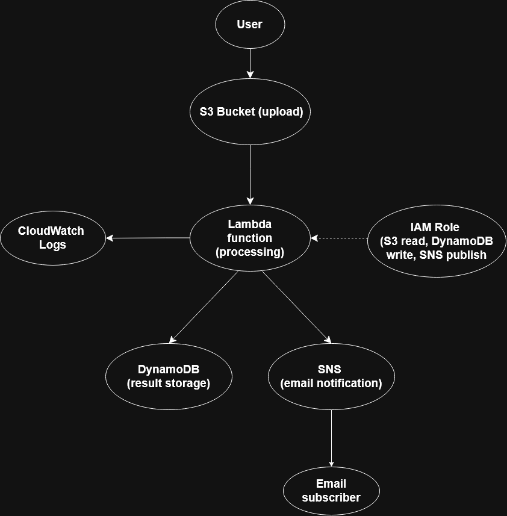
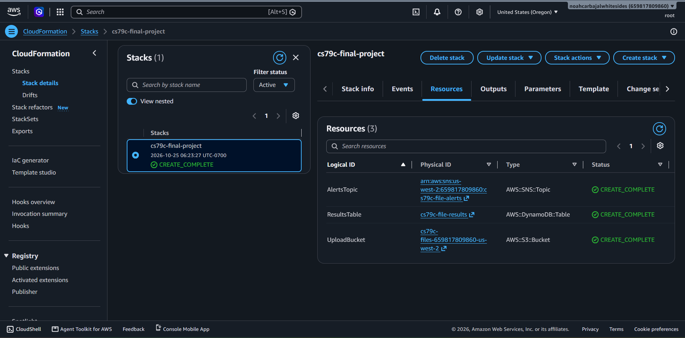
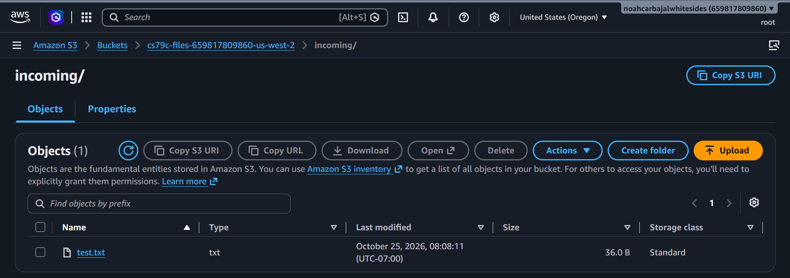
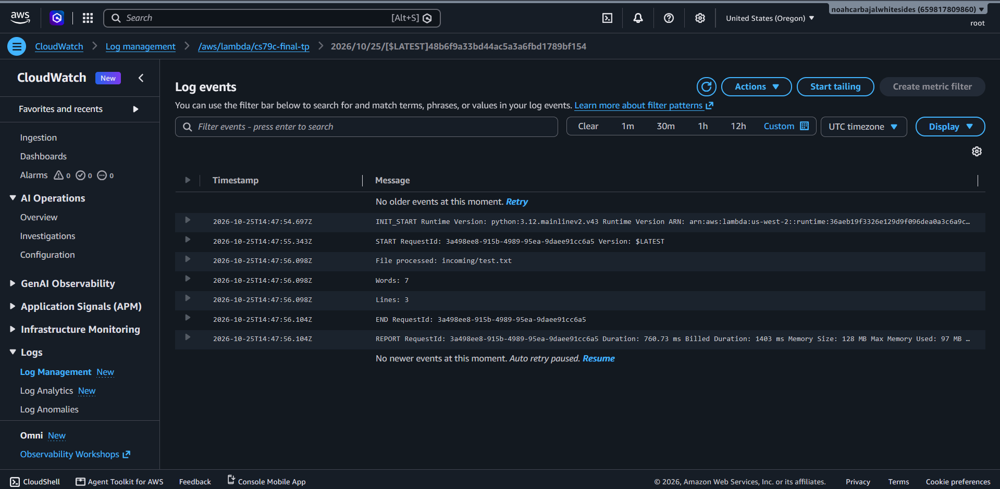
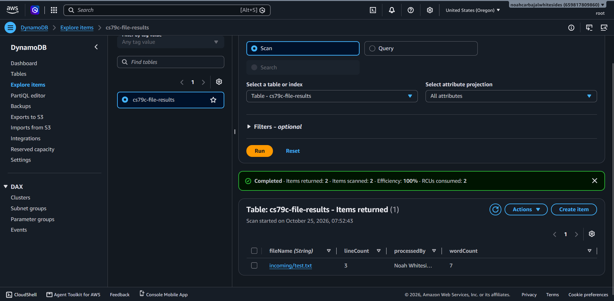

# Serverless Text File Processor

This project is a serverless application built using AWS services, which automatically processes uploaded text files. This application counts the words and lines in each uploaded file, stores the result in DyanoDB, and returns the result to an email subscriber via SNS.

AWS Lambda is utilized to remove the need for servers, making this a serverless event-driven pipeline.

# Architecture

## Diagram:

## AWS Services Used:
- S3
- Lambda
- DynamoDB
- SNS
- IAM
- CloudWatch

## Process:
- A text file is uploaded to the S3 bucket
- A Lambda function is triggered by the S3 uploaded
- The Lambda function counts the words and lines in the text file
- The results are stored in DynamoDB
- SNS sends an email notification to the subscriber with the results of the Lambda function
- CloudWatch records the Lambda execution logs

# Setup:

- Deploy cs79c-template.yaml with CloudFormation in us-west-2

- Create a Lambda function using Python version 3.12

- Use cs79c-final-lambda.py in the Lambda function and deploy

- Configure IAM permissions for the Lambda execution role (s3:GetObject, dynamodb:PutItem, sns:Publish)

- Add an S3 trigger to the Lambda function using the bucket created by the template

- Within the S3 trigger, check 'all objects create events' and set the prefix to 'incoming/'

- Open the SNS topic created by the template, and create an email subscription.(Ensure you confirm it)

- Test the application by uploading the provided test.txt file to a folder named 'incoming' within the S3 bucket created by the template

- Ensure the output within the email notification and DynamoDB table returns 7 words and 3 lines.

#Evidence:

